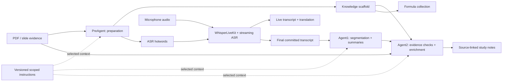
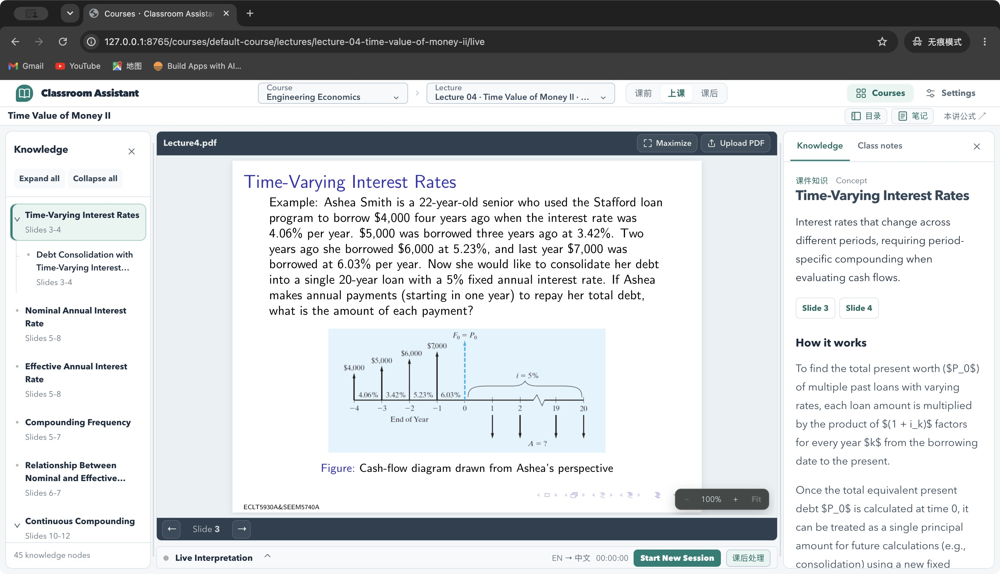
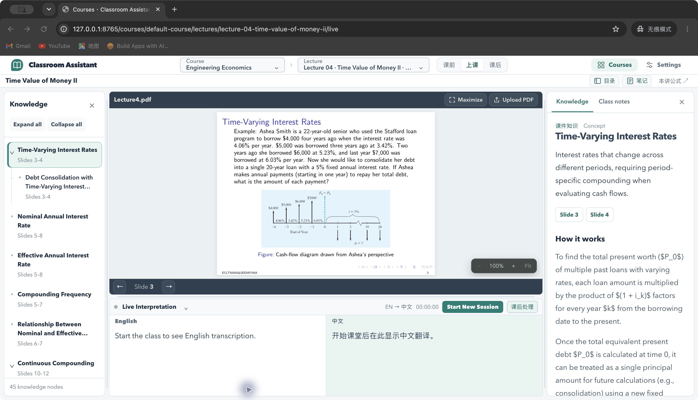
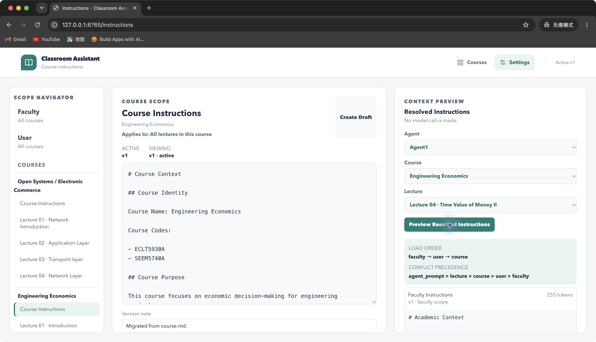
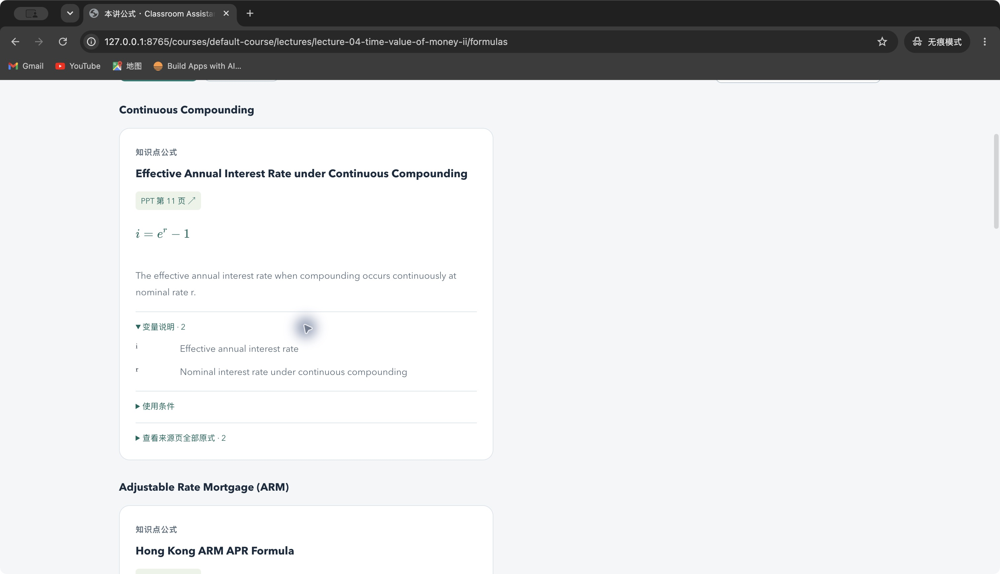
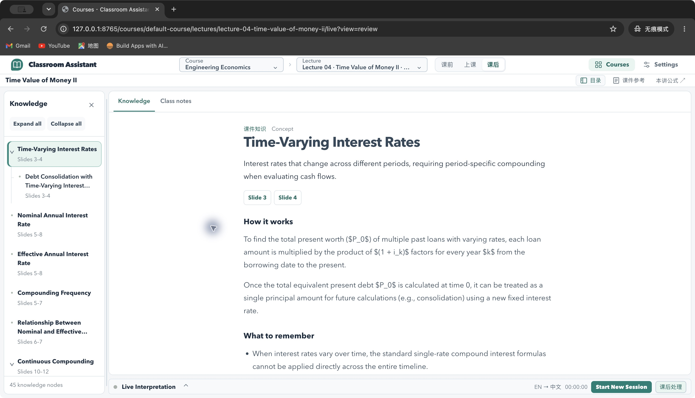
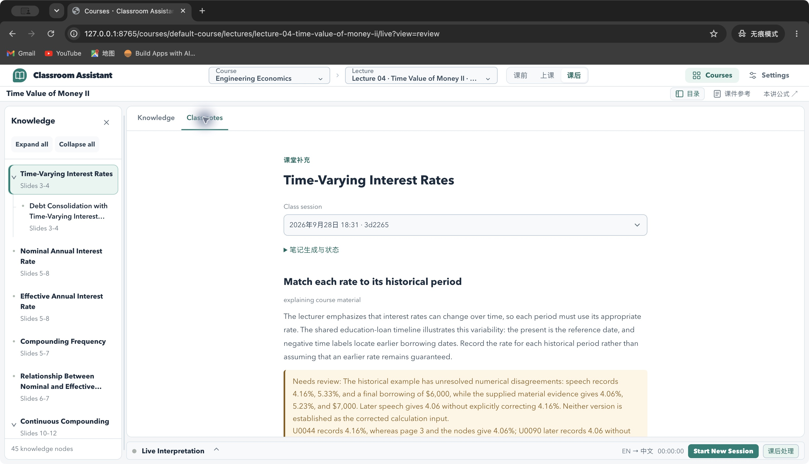
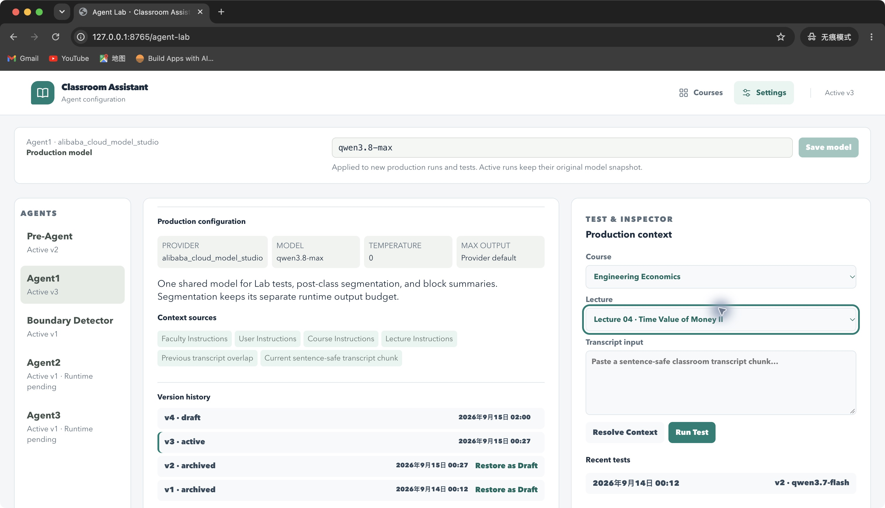

# Lecture AI Assistant

借鉴 Claude Code 的 Subagent 分工与 Memory 持久化上下文机制，结合流式 ASR，构建从课前准备、课堂转写与翻译到课后知识整理的大学课堂助手。当前模型调用使用 Qwen API 与可选的 Codex CLI，由应用负责阶段调度。

A university lecture assistant inspired by Claude Code’s subagent and persistent-context memory mechanisms. It connects lecture preparation, streaming transcription and translation, and source-grounded post-class study notes. The application coordinates Qwen API calls and optional Codex CLI stages.

本仓库包含应用代码、通用提示词、模拟测试，以及经项目所有者同意公开的界面截图。原始课件、录音、完整转写、笔记数据集、个人配置和 API 密钥保留在本地。

The repository contains application code, generic prompts, mock-based tests, and UI screenshots approved for publication by the project owner. Original course files, recordings, complete transcripts, note datasets, personal configuration, and API credentials remain local.

## Learning workflow / 学习流程



课前从课件生成知识结构和课程热词；上课时显示原文与译文；课后将已提交转写整理成语义块，并依据课件核对术语、关联知识点、补充课堂讲解。公式页面从已有课件证据和公式节点建立索引。

Before class, source evidence becomes a knowledge scaffold and ASR vocabulary. During class, the workspace displays source text and translation. After class, committed transcripts become semantic blocks, evidence checks, knowledge links, and lecturer supplements. A separate formula view indexes existing source equations and formula nodes.

## Screenshots / 界面预览

以下图片截自当前实际应用，学习页面使用 **Engineering Economics — Lecture 04 · Time Value of Money II**。截图展示现有功能与已完成的课后产物；实时字幕面板截图处于开始上课前的状态。

These screenshots show the running application and existing post-class outputs for **Engineering Economics — Lecture 04 · Time Value of Money II**. The live caption panel is shown before starting a new classroom session.

### Classroom workspace / 上课工作区

课件、知识树和知识解释并排显示，便于在讲课过程中定位原始页码和相关概念。

Source slides, the knowledge tree, and explanations are displayed together so students can navigate concepts alongside the original material.



<details>
<summary>Live transcription and translation panel / 实时转写与翻译面板</summary>

原文与译文面板可在上课工作区展开。本图展示开始新会话前的界面，未为截图额外录音或调用识别服务。

The source and translated caption panel opens within the classroom workspace. This screenshot shows the interface before a new session; no additional recording or ASR request was made for the capture.



</details>

### Memory and scoped context / Memory 与分层上下文

按 Faculty、User、Course、Lecture 管理长期指令，查看生效版本、加载顺序和优先级，并预览某个 Agent 实际得到的上下文。预览本身不调用模型。

Manage persistent instructions by faculty, user, course, and lecture; inspect active versions, loading order, and precedence; and preview the context selected for an agent without a model call.



### Formula collection / 公式汇总

集中查看公式、变量定义、适用条件和来源页码。页面读取已有证据与知识节点，不在打开页面时重新调用模型生成公式。

Review equations, variable definitions, conditions, and source pages. The page reads existing evidence and knowledge nodes rather than generating equations through a new model call.



### Post-class knowledge / 课后知识点总结

通过知识树复习概念、推导、应用方式和需要记住的结论，并保留课件来源关联。

Revisit concepts, reasoning, applications, and key takeaways through the knowledge tree, with links back to source material.



<details>
<summary>Lecturer supplements and evidence review / 课堂补充与证据核对</summary>

课堂补充与课前知识分开展示；缺乏足够证据的数字或公式冲突保留为待复核项。

Lecturer supplements are distinguished from prepared knowledge. Numerical or formula conflicts without sufficient evidence remain marked for review.



</details>

<details>
<summary>Agent Lab: prompts, models, and context / Agent 管理</summary>

查看 Agent 职责、模型、上下文来源及提示词的草稿、生效与历史版本。截图中的 Agent2 “Runtime pending” 指 Agent Lab 的独立测试入口尚未接通；应用中的课后 Agent2 证据核对与知识补充链路已经实现。Agent3 的自动课程记忆索引仍为占位定义。

Inspect agent responsibilities, models, context sources, and draft, active, and archived prompt versions. Agent2’s “Runtime pending” label concerns its standalone Agent Lab test entry; the application already runs the post-class Agent2 evidence-checking and enrichment pipeline. Agent3’s automatic course-memory indexer remains a placeholder.



</details>

## Subagent design and implementation / Subagent 设计原理与实现

Claude Code 的 Subagent 将专门任务交给具有独立上下文、系统提示词及工具权限的子代理，再把结果返回调用方。这种分工减少主上下文中无关过程信息的累积。参见 [Claude Code Subagents](https://code.claude.com/docs/en/sub-agents)。

Claude Code delegates specialized tasks to subagents with separate contexts, system prompts, and tool permissions, returning results to the caller while reducing unrelated intermediate information in its context. See [Claude Code Subagents](https://code.claude.com/docs/en/sub-agents).

本项目把这一思路落到应用控制的分阶段流程中：每个阶段有明确的任务、输入材料、提示词和输出格式。阶段间传递经过校验的结构化产物与证据引用，按任务装配上下文；由应用决定执行顺序、并发、重试和恢复。当前并非由 Claude Code 原生 Subagent 运行时执行这些阶段。

This project implements that design through application-managed stages. Each stage has a defined task, evidence input, prompt, and output contract. Validated structured artifacts and evidence references connect the stages, with context assembled for each task. The application controls ordering, concurrency, retries, and recovery. These stages currently execute through the application rather than Claude Code’s native subagent runtime.

| Stage / 阶段 | Input / 输入 | Responsibility and output / 职责与产物 |
| --- | --- | --- |
| **PreAgent** | PDF/MinerU evidence; selected scoped instructions / 课件证据与选定指令 | Understand bounded slide evidence, extract knowledge candidates, build and validate a typed scaffold, enrich explanations, and derive speakable ASR hotwords / 理解限定范围的课件证据，提取候选知识，建立并校验结构化知识树，补充解释，生成可发音热词 |
| **Agent1** | Final committed transcript; run-specific context / 已提交转写与本次上下文 | Segment the lecture into ordered, non-overlapping semantic blocks, then summarize blocks while preserving meaning, numbers, conditions, and uncertainty / 将转写分为有序、不重叠的语义块，保留原意、数字、条件和不确定性后整理内容 |
| **Agent2** | Agent1 blocks; scaffold; retrieved source evidence / 语义块、知识树与检索到的课件证据 | Propose auditable ASR patches, link fragments to knowledge nodes, and add source-grounded lecturer supplements / 生成可审计的转写修订，将片段关联到知识节点，补充有证据支撑的课堂讲解 |

Agent1 的课后分段先接收完整的规范化最终转写，超出预算会报错，而不是静默截掉后半节课；块内整理再以受控并发执行。Agent2 先利用紧凑的知识与页码索引选出相关证据，再读取选中内容，减少把整份课件重复塞进每次请求的开销。

Post-class Agent1 segmentation receives the complete normalized final transcript and fails explicitly if it exceeds the configured budget, rather than silently truncating the lecture. Block processing then uses bounded concurrency. Agent2 first selects relevant evidence using compact node and page indexes, then reads the selected content instead of repeating the whole slide deck in every request.

Agent2 的修订需要定位到原文中的具体出现位置并验证引用。数字和公式还需要更严格的同一例题、同一语境证据；无法确认时标记待复核。原始转写、课前知识和课后补充分别保留，便于追溯。

Agent2 patches identify specific transcript occurrences and validate their quoted text. Numerical and formula changes require stronger corroboration within the same example and context; unresolved cases are flagged. Original transcripts, prepared knowledge, and post-class supplements remain distinct for traceability.

实现入口：[PreAgent](preagent_scaffold.py)、[Agent1](agent1_v1.py)、[Agent2 ASR checks](agent2_asr.py)、[Agent2 enrichment](agent2_enrichment.py)、[isolated Codex preparation](codex_scaffold.py)。

## Memory mechanism / Memory 机制

Claude Code 的文件式 Memory 将指令或记忆保存在模型上下文之外，需要时再读入上下文。其 `CLAUDE.md` 是人工编写的持久指令，Auto Memory 则记录模型积累的经验。参见 [Claude Code Memory](https://code.claude.com/docs/en/memory)。

Claude Code’s file-based memory persists instructions or remembered information outside the model context and loads it when needed. `CLAUDE.md` holds human-authored instructions, while Auto Memory stores accumulated learnings. See [Claude Code Memory](https://code.claude.com/docs/en/memory).

本项目已经实现的 Memory 主要是**人工控制的分层指令与可复用运行产物**。它通过保存并重新加载上下文影响后续请求，不涉及训练或修改模型权重。具体分为三部分：

The implemented memory mechanism centers on **human-controlled scoped instructions and reusable runtime artifacts**. Persistence and reloading shape later model requests without training or modifying model weights. It has three parts:

### 1. Scoped instruction memory / 分层指令记忆

| Scope / 层级 | Persistent context / 长期上下文 | Scope boundary / 作用范围 |
| --- | --- | --- |
| Faculty | 学院与学科背景 / Academic and disciplinary context | 跨课程的学术背景 / Academic context across courses |
| User | 语言、表达和学习偏好 / Language and study preferences | 用户偏好 / User preferences |
| Course | 课程目的、术语和要求 / Course goals, terminology, and requirements | 明确指定的课程 / Explicitly selected course |
| Lecture | 本讲的特殊要求 / Lecture-specific instructions | 明确指定的讲次 / Explicitly selected lecture |

解析器按 `faculty → user → course → lecture` 顺序处理，只加载 Agent 的上下文策略允许且内容非空的层级。提示词中声明的冲突优先级为 `agent_prompt > lecture > course > user > faculty`；这表示请求中的指令优先关系，并非模型之外的权限控制。

The resolver processes scopes in `faculty → user → course → lecture` order, including only nonempty layers permitted by the agent’s context policy. The declared instruction precedence is `agent_prompt > lecture > course > user > faculty`; it expresses prompt priority, not an external permission-enforcement mechanism.

指令保存为本地文件，并具备草稿、生效、历史版本、比较和恢复流程。运行时保存选定指令的内容与版本快照；后续修改指令或模型设置不会替换已开始运行使用的快照。上下文预览可以直接查看实际加载的层级。

Instructions live in local files with draft, activation, history, comparison, and restoration workflows. Runs retain the selected instruction content and version snapshots, so later instruction or model changes do not replace a run’s original configuration. Context preview exposes the layers actually selected.

### 2. Course and session artifacts / 课程与会话产物

知识树、课件证据、热词、转写和课后整理按课程、讲次、会话保存，后续步骤按明确标识读取所需产物。会话绑定课前准备结果和热词快照；课件或准备产物变化后需要重新验证。传统上下文加载器校验所选课程路径，不扫描其他课程，也不会隐式借用另一门课的指令。

Scaffolds, source evidence, hotwords, transcripts, and post-class results are stored by course, lecture, and session, then loaded by explicit identity. A session binds preparation outputs and vocabulary snapshots; changed preparation evidence must be revalidated. The legacy context loader validates the selected course path without scanning or falling back to another course’s instructions.

### 3. Recovery caches / 断点与恢复缓存

处理记录和缓存用输入、提示词、模型配置及相关证据的指纹区分运行。只复用绑定一致、已完成并通过校验的结果，避免服务中断后重复处理或混用旧结果。这类缓存保存执行状态；它与自动提炼、检索历史学习经验的记忆库是不同机制。

Run records and caches bind results to fingerprints of inputs, prompts, model configuration, and relevant evidence. Recovery reuses completed, validated results only when their bindings match, avoiding unnecessary reruns or stale-result mixing. These caches preserve execution state and are distinct from an automatically learned, searchable memory store.

目前的 Agent3 自动课程记忆索引器仍为占位定义，`context_loader.py` 明确不读取 `courses/{course_id}/memory`。因此已实现的分层指令、版本快照、产物复用和恢复机制可以明确介绍；自动学习型课程 Memory 检索不能被描述成现有运行能力。

Agent3’s automatic course-memory indexer remains a placeholder, and `context_loader.py` explicitly does not load `courses/{course_id}/memory`. Scoped instructions, snapshots, artifact reuse, and recovery are implemented; automatic learned-course-memory retrieval should not be presented as an active capability.

实现入口：[instruction store and resolver](scoped_instructions.py)、[context loader](context_loader.py)、[Agent Lab](agent_lab.py)、[course/session catalog](workspace_catalog.py)。

## ASR methods: WhisperX and the active streaming pipeline / ASR 原理与当前链路

### WhisperX method / WhisperX 方法

WhisperX 使用 VAD 找出语音区间，通过 faster-whisper 批量识别，再用 wav2vec2 等声学对齐模型把已识别文字强制对齐到音频，细化单词时间戳；可选的 pyannote.audio 说话人分离根据声音区间赋予说话人标签。参见 [WhisperX](https://github.com/m-bain/whisperX)。

WhisperX detects speech regions with VAD, performs batched ASR through faster-whisper, and uses alignment models such as wav2vec2 to force-align recognized text to audio for word timestamps. Optional pyannote.audio diarization assigns speaker labels to speech intervals. See [WhisperX](https://github.com/m-bain/whisperX).

```text
Audio → VAD → Whisper transcription → Forced alignment → Optional diarization
                                                         ↓
                                             Timed words + speaker labels
```

这是 WhisperX 的方法说明。当前课堂入口运行的是下述 WhisperLiveKit 流式链路；尚未接入 WhisperX 包、词级声学强制对齐或说话人分离。应用的课后证据核对不等同于声学对齐，翻译则由独立翻译模型完成。

This describes WhisperX’s method. The classroom entry currently runs the WhisperLiveKit streaming pipeline below; it does not invoke the WhisperX package, word-level acoustic forced alignment, or diarization. Post-class evidence checking is separate from acoustic alignment, and translation uses a separate model.

### Active classroom pipeline / 当前课堂处理流程

1. **采集与流式传输 / Capture and streaming:** 浏览器麦克风音频转换为 16 kHz PCM，通过 WebSocket 发送到服务端。Browser microphone audio becomes 16 kHz PCM and is sent to the server over WebSocket.
2. **课程热词 / Course vocabulary:** PreAgent 从知识树筛选可发音的专业术语，过滤公式符号，再以有限数量和保守权重注入本次识别请求。PreAgent selects speakable technical terms, excludes formula symbols, and supplies a bounded, conservatively weighted vocabulary for the ASR request.
3. **语音识别 / Recognition:** 内置 WhisperLiveKit 负责音频处理和流式结果衔接，课堂路径使用 Qwen 流式 ASR，并启用语义标点。Bundled WhisperLiveKit handles audio processing and streaming integration; the classroom path uses Qwen streaming ASR with semantic punctuation.
4. **稳定文本与临时尾部 / Stable text and provisional tail:** 已提交部分保持稳定，未完成部分允许替换修订；保存快照并去重，支持断线恢复。Committed text remains stable while provisional trailing text can be revised; snapshots and deduplication support reconnection.
5. **增量翻译 / Incremental translation:** 独立 Qwen 翻译模型处理滚动原文，译文也区分稳定部分与临时尾部，减少重复和闪动。A separate Qwen translation model processes rolling source text, with stable and provisional translated portions to reduce repetition and flicker.
6. **课后整理 / Post-class processing:** Agent1 读取最终已提交原文，Agent2 再结合课件做可追溯修订与知识补充。Agent1 consumes the final committed source transcript; Agent2 then uses slide evidence for traceable corrections and enrichment.

WhisperLiveKit 名称并不表示每种配置都运行 Whisper 模型。仓库包含其他可选后端，但上面描述的是本应用实际配置的课堂路径。

The WhisperLiveKit name does not imply every configuration runs a Whisper model. The bundled code supports other optional backends; the steps above describe this application’s configured classroom path.

实现入口：[classroom realtime](classroom_realtime.py)、[Qwen streaming adapter](whisperlivekit/qwen_audio_streaming.py)、[source stabilization](whisperlivekit/snapshot_text_stabilizer.py)、[translation stabilization](whisperlivekit/translation_snapshot_stabilizer.py)。

## Setup / 安装

Use Python 3.12 and Node.js/npm. MinerU is optional for document conversion and is installed separately.

```bash
python3.12 -m venv .venv
source .venv/bin/activate
pip install -r requirements.txt
cp .env.example .env
npm --prefix frontend ci
npm --prefix frontend run build
python main.py
```

Set your own credentials in `.env`, including a Beijing-region `DASHSCOPE_API_KEY`. Open http://127.0.0.1:8765/courses to create a course and lecture, upload materials, and prepare a classroom session. Optional Codex stages require an installed Codex CLI with ChatGPT login. There is no automatic provider fallback.

在本地 `.env` 填写自己的密钥，再打开课程页面创建课程、讲次并上传课件。课堂数据保存在本地的 `courses/`、`data/` 等目录，这些目录被 Git 忽略。使用 Codex 阶段时需另行安装 Codex CLI 并登录。

## Verification / 验证

Install `pytest` and `pytest-asyncio` to run backend tests:

```bash
pip install pytest pytest-asyncio
python -m pytest -q
npm --prefix frontend test
npm --prefix frontend run build
```

Regression files depending on actual lecture snapshots are omitted from this upload. No production build bundles local lecture PDFs or preparation outputs. Live microphone, paid model calls, MinerU, and optional ASR backends require separate local configuration and verification.

依赖真实课堂快照的回归测试未纳入上传；前端构建不会打包本地 PDF 或课前产物。实时麦克风、真实模型请求及可选 ASR 后端需要另行配置和验证。

## Privacy / 隐私

This is a fresh source snapshot with no original Git history. Only the selected UI screenshots above are approved classroom examples. Raw course directories, private instructions, logs, recordings, complete transcripts, model-response datasets, and credentials are excluded. `.gitignore` does not remove files already committed.

本仓库使用全新提交，不包含原项目历史。经同意公开的课堂示例仅限上述界面截图；原始课程目录、私人指令文件、日志、录音、完整转写、模型响应数据集和密钥均未上传。已经提交过的文件不会因 `.gitignore` 而自动移除。

## Third-party code / 第三方代码

The bundled `whisperlivekit/` tree includes third-party ASR code and assets. Preserve its existing `LICENSE.whisperlivekit` notice. Optional backends may require packages beyond the minimal application requirements. No project-wide license is selected for this snapshot.
